# C4 Architecture

This document describes the architecture of react-native-network-tools using the [C4 model](https://c4model.com): system context, containers, components, and two dynamic views (capturing a request, recording a session). The last section, [Session subsystem in depth](#session-subsystem-in-depth), explains how the recorder, the events and listeners, and the NDJSON file store work together.

The diagrams are Mermaid flowcharts drawn in C4 notation, because Mermaid's native C4 syntax lays out poorly on GitHub. Legend:

| Shape / colour | C4 element |
| --- | --- |
| Dark blue box | Person |
| Blue box | Element inside the scope of the diagram (system, container or component) |
| Grey box | External system or element outside the scope |
| Cylinder | Data store |
| Dashed box | Planned, not built yet |

---

## Level 1 — System context

The library runs inside the host app's process. It sees the app's HTTP traffic from inside the app's own networking stack, so there is no proxy and nothing leaves the device.

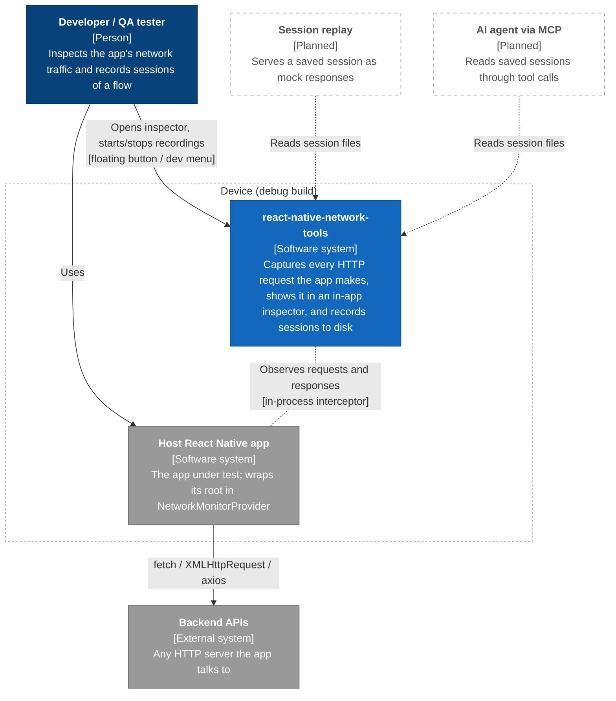

---

## Level 2 — Containers

The system has a JavaScript part, a native part per platform, and an on-device file store. The JS part and the native part talk through one TurboModule (`NetworkTools`) and two native events.

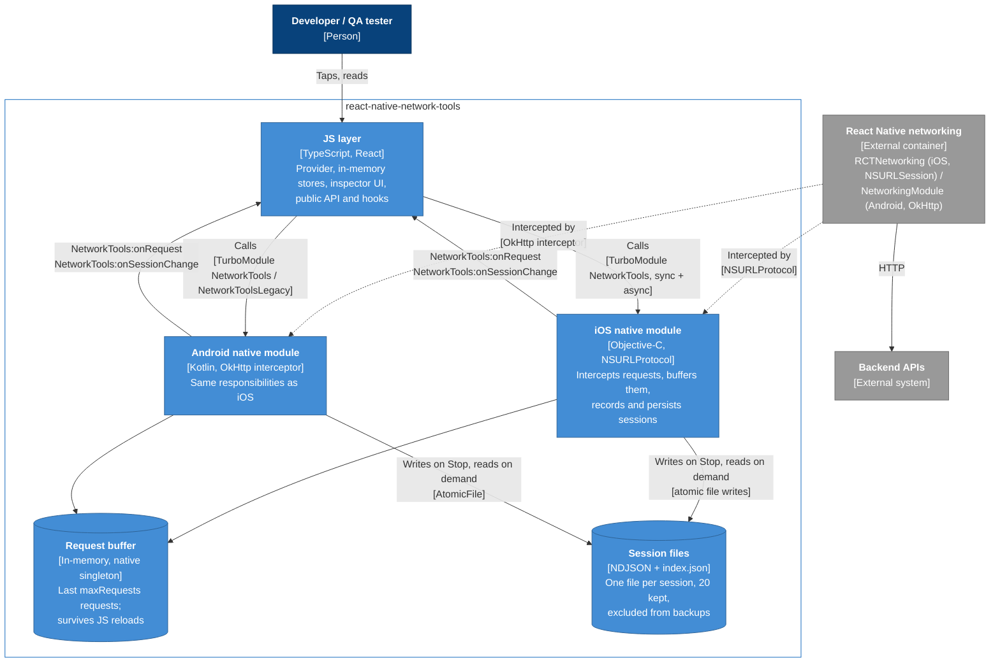

**Build gating.** Capture is debug-only. On iOS the interceptor is registered only inside `#if DEBUG` in `NetworkToolsManager.activate`. On Android it follows `BuildConfig.NETWORK_TOOLS_ENABLED`, which is true only for the debug build type, and the `android-no-op` artifact registers no module at all. In a release build the JS layer finds capture inactive (or the module missing) and shows the "capture off" state. No session folder is ever created.

---

## Level 3 — Components: JS layer

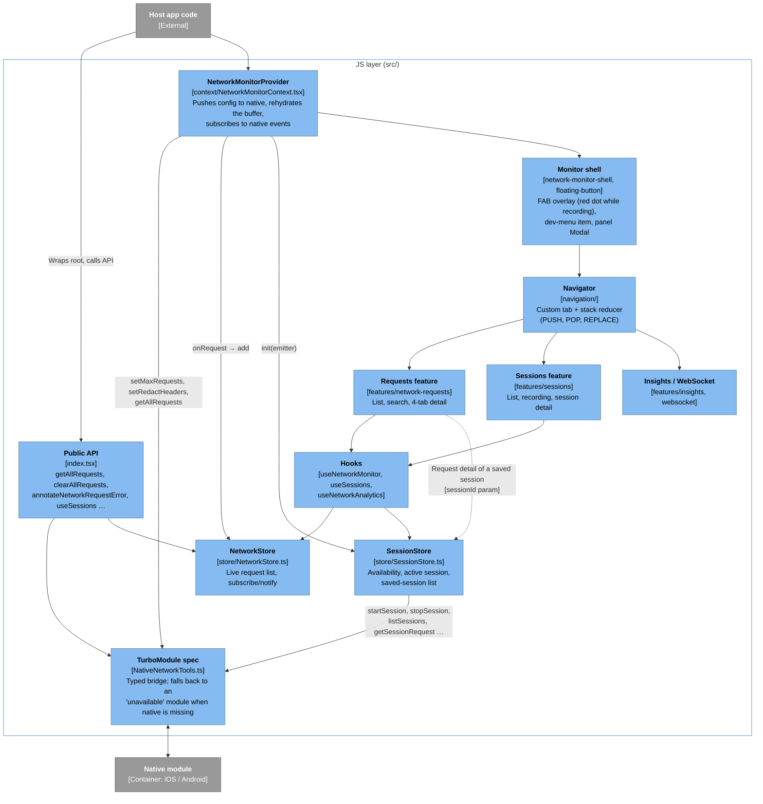

---

## Level 3 — Components: native module

iOS and Android use the same component layout. Each row names the iOS class first and the Android class second.

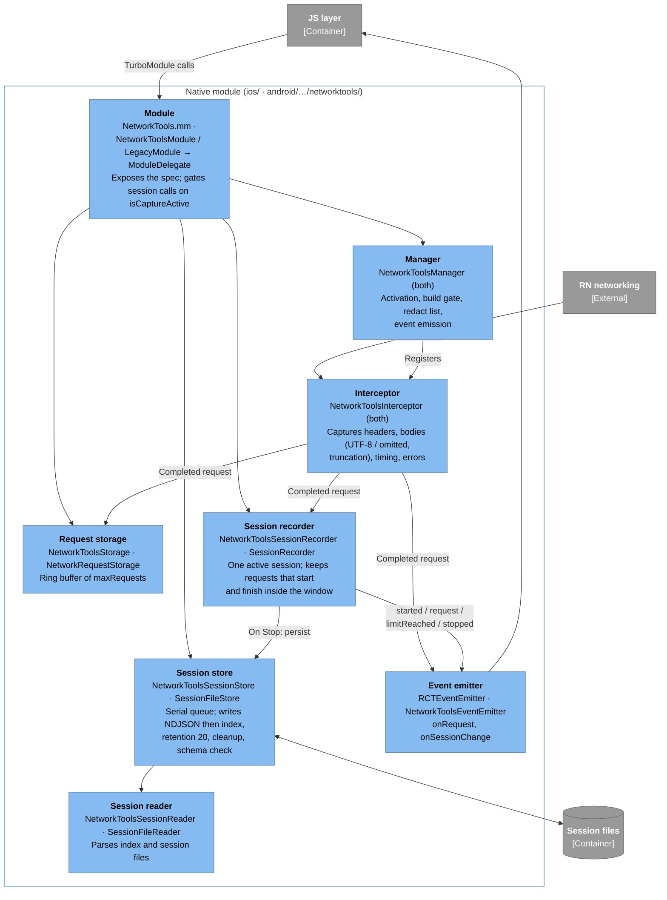

---

## Dynamic view — capturing a request

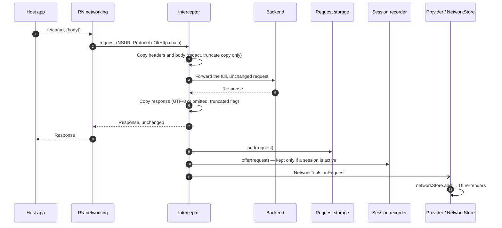

After a JS reload, the provider calls `getAllRequests()` to refill `NetworkStore` from the native buffer. The native buffer outlives the JS runtime.

---

## Dynamic view — recording a session

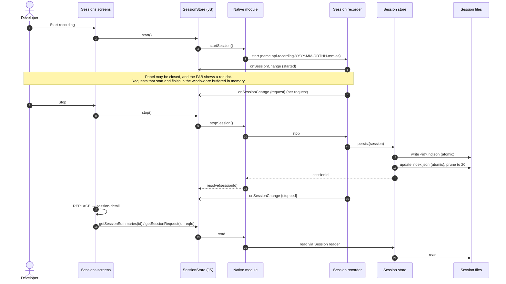

---

## Session subsystem in depth

A session moves through three places, each owned by one component:

| Where | Owner | Holds | Lifetime |
| --- | --- | --- | --- |
| Native memory | Session recorder | The active session: id, name, start time, the request list, `limitReached` | From Start to Stop. Survives JS reloads, lost if the app process dies. |
| Disk | Session store | `index.json` plus one `<id>.ndjson` per saved session | Until deleted, pushed out by retention, or wiped by a schema change |
| JS memory | `SessionStore` (JS) | A **view** of both: `availability`, `activeSession`, `activeRequests` (summaries), `sessions` (index entries) | One JS runtime. Rebuilt from native on every `init`. |

The JS store owns no session data of its own. Native is the source of truth, and the JS store mirrors it through two channels: **calls** (JS asks, native answers) and **events** (native tells JS that something changed).

### How the pieces connect

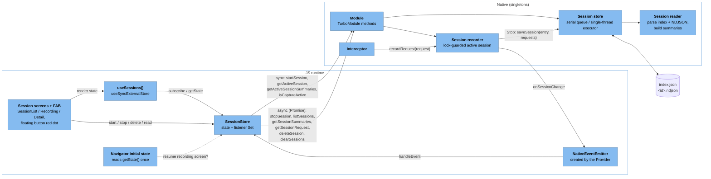

### Recorder states

The recorder is a singleton with one lock. `_sessionId` (`sessionId` on Android) being set **is** the "recording" state, so only one recording can exist at a time.

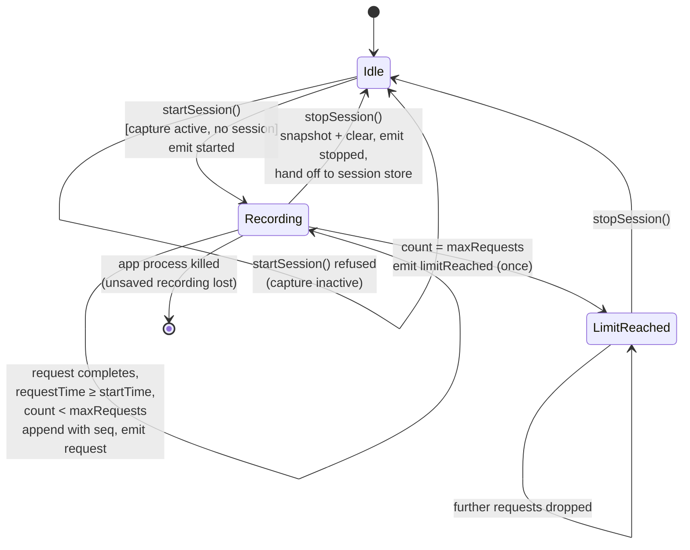

Which requests belong to a session is decided in one place, `recordRequest`. The interceptor calls it when a request **completes**. The recorder keeps the request only if a session is active at that moment **and** the request's `requestTime` is at or after the session's start. A request that started before Start is ignored, and one still in flight at Stop arrives after the session is cleared and is ignored too. The per-session limit reuses `maxRequests`.

On Stop the recorder copies its list and clears its state while holding the lock, then emits `stopped` and hands the copy to the session store. A request that completes during the disk write cannot slip into the stopped session.

### The event contract: `NetworkTools:onSessionChange`

Every event carries the full current `activeSession` (or `null`), so the JS side can always replace its copy instead of patching it.

| `type` | Sent when | `activeSession` | Extra | JS `SessionStore` reaction |
| --- | --- | --- | --- | --- |
| `started` | `startSession()` succeeded | the new session | — | set `activeSession`, empty `activeRequests` |
| `request` | a request was added | updated `requestCount` | `addedRequest`: a summary (`id, seq, method, url, responseCode, duration, requestTime, error`) | append the summary unless its `id` is already listed |
| `limitReached` | the first request over the limit | `limitReached: true` | — | update `activeSession` (the Recording screen shows the notice) |
| `stopped` | `stopSession()` cleared the recorder | `null` | — | clear `activeSession` and `activeRequests` |

Events carry **summaries**, never full requests, so a recording with large bodies does not push megabytes across the bridge. Full requests are read from disk only when a detail screen asks for one.

The duplicate check on `request` handles a race during `init`: JS reads `getActiveSessionSummaries()` and subscribes right after, so a request completing in between can arrive in both.

Native events are emitted **outside** the recorder lock, so a slow JS listener can never block the interceptor thread.

### The listener chain

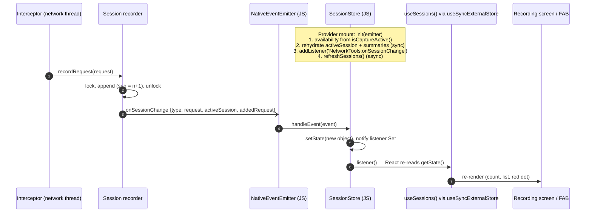

The JS store is a plain external store with a `subscribe` / `getState` pair, the shape `useSyncExternalStore` expects. Each `setState` replaces the state object, so React's identity check sees the change and every mounted consumer re-renders: the floating button's red dot, the list banner, and the live list on the Recording screen. Consumers that are not mounted (the panel is closed) are not notified, but the store keeps updating, so reopening the panel shows current data.

The Provider owns the subscription. On unmount it calls `sessionStore.dispose()`, which removes the native listener. A JS reload destroys the JS store, and the next mount rebuilds it from native.

### Writing to disk: NDJSON and the save protocol

Why NDJSON (one JSON object per line) instead of one JSON array or a database:

- **Append-shaped.** A session is an ordered list of independent records, so each line is complete on its own. A future streaming writer could append lines during recording with no format change.
- **Damage stays local.** The reader skips any line that does not parse, so one bad line costs one request, not the session.
- **Tool-friendly.** `jq`, `grep` and `wc -l` work on it directly, and an MCP server or a replay engine can stream it line by line without loading the whole file.
- **No dependency.** Both platforms write it with their built-in JSON serializers; nothing needs a migration.

`index.json` is the catalogue. Listing sessions reads only the index, never the session files.

All file work runs on one serial queue (iOS `dispatch_queue` "com.networktools.sessions", Android single-thread executor). Saves, reads, deletes and housekeeping therefore never interleave, with no file locks. Results go back to the module through completion callbacks, which resolve the JS promise.

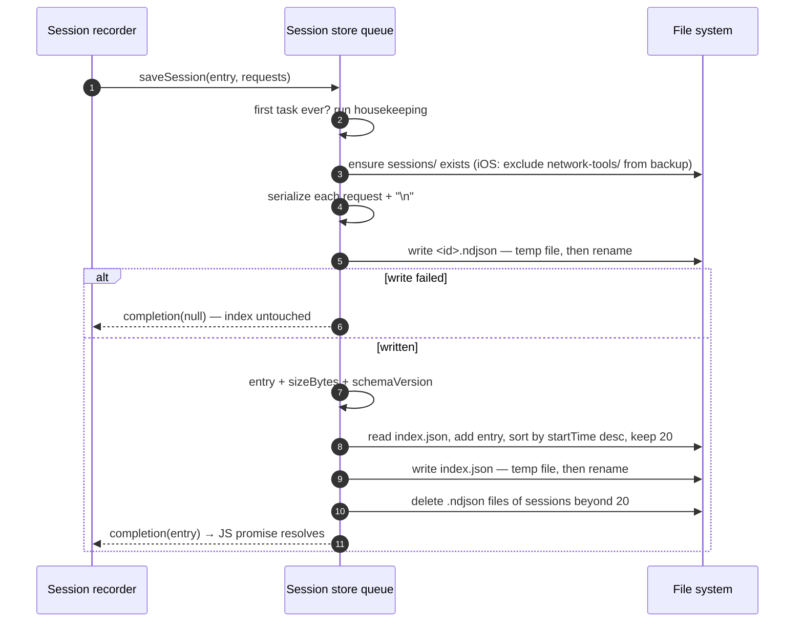

**Crash safety follows from the order:** session file first, index second, both written atomically (iOS `NSDataWritingAtomic`, Android `AtomicFile`).

| Crash point | State on disk | Recovery |
| --- | --- | --- |
| During the `.ndjson` write | Old files untouched, temp file left over | None needed; nothing references it |
| After the `.ndjson`, before the index | A session file the index doesn't list (orphan) | Housekeeping deletes it on next start |
| During the index write | Previous `index.json` intact | The new session is an orphan, as above |
| After both | Consistent | — |

The invariant is: **every session listed in the index has a complete file.** Readers can trust the index.

### Housekeeping

Housekeeping runs once per process, before the first task on the queue.

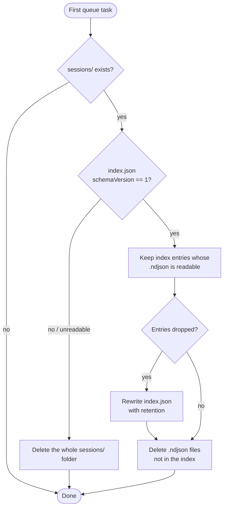

### Reading back

| JS call | Native work on the queue | Returns |
| --- | --- | --- |
| `listSessions()` | read `index.json` | index entries (JS sorts newest first) |
| `getSessionSummaries(id)` | parse `<id>.ndjson` line by line, project each line to a summary | summaries (JS sorts by `seq`) |
| `getSessionRequest(id, reqId)` | parse `<id>.ndjson`, return the line with that `id` | one full request |
| `deleteSession(id)` | remove the entry from the index, then delete the file | — then JS calls `refreshSessions()` |
| `clearSessions()` | delete the whole folder | — then JS calls `refreshSessions()` |

If a session file is missing or not valid UTF-8 when read, the store removes that session from the index and returns nothing, so a broken session disappears instead of failing every time. Saved-session reads go through the store, never through `SessionStore` state, because JS state holds only the index and the active session.

The request detail screen is shared by live and saved requests. Without a `sessionId` param it reads `NetworkStore` (live traffic); with one it calls `getSessionRequest`.

### What survives what

| Event | Active recording | Saved sessions | JS session state |
| --- | --- | --- | --- |
| Panel closed | keeps recording (red dot on FAB) | kept | kept |
| JS reload (Fast Refresh, Metro reload) | keeps recording in native memory | kept | rebuilt by `init`; the navigator opens on the Recording screen |
| App killed or crashed | **lost** (never written) | kept | — |
| App reinstalled / data cleared | lost | lost | — |
| Library upgrade with a new `schemaVersion` | — | wiped by housekeeping | — |
| Device backup / restore | — | not included (excluded from backup) | — |

The file layout and field reference are in [SESSION_FILE_FORMAT.md](./SESSION_FILE_FORMAT.md).
